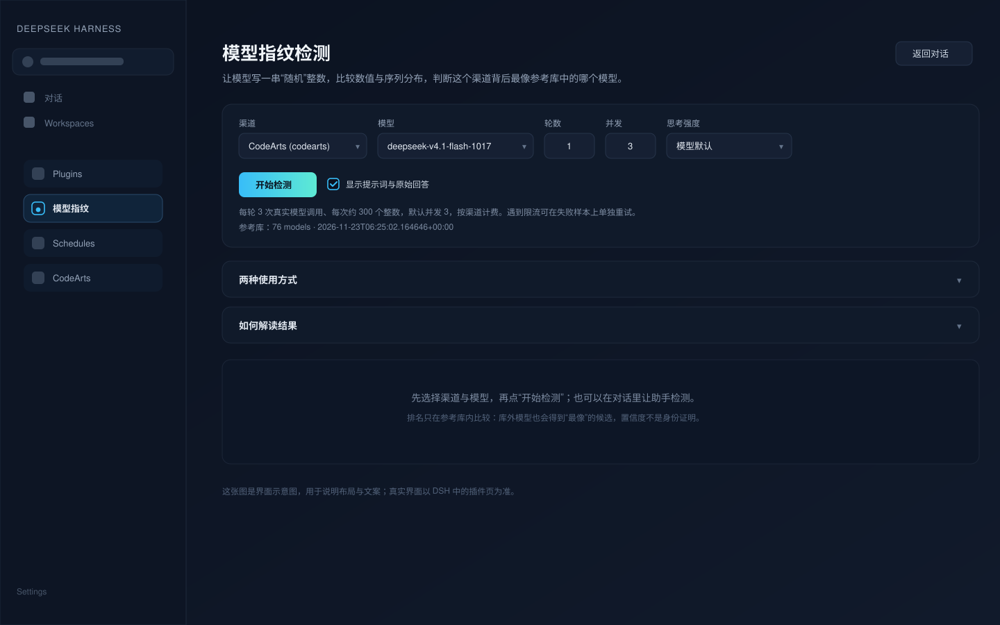
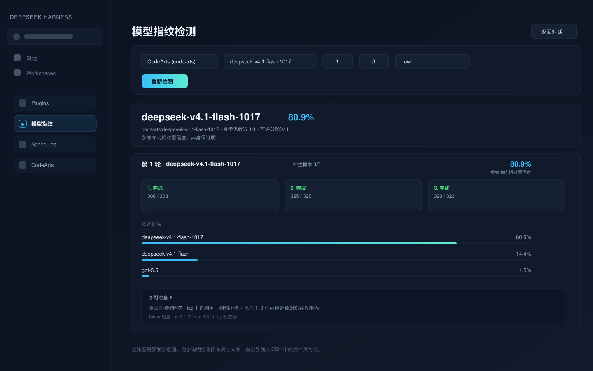

# dsh-llm-detector

[简体中文](README.md) · [English](README.en.md)

**Ask the models registered in DeepSeek Harness to write a few hundred “random” integers, then tell which model a provider route is actually served by.**

[](#install)
[](https://www.npmjs.com/package/dsh-llm-detector)
[](LICENSE)
[](#data-and-reference-bank)

A language model's “random numbers” are not uniform: each model has fairly stable preferences for
values, ranges, last digits and step sizes. This plugin asks the model to write about 300 integers
from 1 to 355 by first instinct, compares the result with a frozen reference bank, and returns a
ranking with calibrated confidence. A single failed sample can be retried on its own, so rate limits
never force a whole round to be re-run.

Detection goes through DSH's own `llm` service, using the provider, credentials and adapter already
configured in your profile — so it measures the route you are actually using, not a Base URL you
type in again.

> Ported from [Ikaleio/lm-detector](https://github.com/Ikaleio/lm-detector) (MIT). See
> [Acknowledgements](#acknowledgements).

## Preview

The sidebar entry opens the detection panel: pick a channel, model, rounds, parallelism and
reasoning effort; sample progress is shown live, and failed samples can be retried individually.



After a round you get the top candidate, confidence, candidate distribution, sequence check and token
usage:



> Both images are layout illustrations; the real interface is the plugin page inside DSH.
> For a real screenshot: open **Model fingerprint** in a signed-in DSH page and use the system
> screenshot tool.

## Features

- 🧭 **Sidebar panel**: pick provider and model, watch progress live, cancel, retry failed samples.
- 💬 **Works from chat**: say “detect the current model's fingerprint” and the assistant calls the
  `llm_fingerprint` tool.
- 🎚️ **Reasoning effort**: reads the efforts the model actually supports (low/high/max …), or keeps
  the model default.
- 📊 **Explainable results**: top candidate, top 5, calibrated confidence, sequence check, per-sample
  integer counts and failure reasons.
- 🕘 **Persistent history**: finished runs are saved locally across restarts; filter, inspect full
  snapshots, reuse parameters in one click, clear records, or query history from chat.
- 🔒 **No credentials stored**: requests go through DSH's `llm` service; the panel API never returns
  keys or endpoint URLs.
- 🧱 **Read-only reference bank**: detection never modifies reference data; results are a closed-set
  ranking.

If this plugin is useful, consider [starring it on GitHub](https://github.com/Phoeky/dsh-llm-detector).

## Contents

- [Install](#install)
- [Usage](#usage)
  - [Sidebar panel](#sidebar-panel)
  - [From chat](#from-chat)
  - [Model tool](#model-tool)
- [How it works](#how-it-works)
- [Data and reference bank](#data-and-reference-bank)
- [Limitations](#limitations)
- [Acknowledgements](#acknowledgements)
- [License](#license)
- [Development](#development)

## Install

### Option 1: install by name from the Plugins page (recommended)

The plugin is published on npm as `dsh-llm-detector`:

1. Open DSH's **Plugins** page and click **Add plugin**;
2. Enter `dsh-llm-detector` (pin a version with `dsh-llm-detector@1.2.0` if you prefer), then confirm;
3. The **Model fingerprint** icon appears in the left sidebar. If it does not, refresh the page or
   open a new session.

You can also ask the assistant to install it:

```text
Install the dsh-llm-detector plugin for me
```

The assistant calls `plugin_manager`'s `install_bundle` with the package name `dsh-llm-detector`.

### Option 2: npm

The package is on npm; you can inspect or install it locally:

```bash
npm view dsh-llm-detector version   # 1.2.0
npm pack dsh-llm-detector           # download the tarball and inspect its contents
npm install dsh-llm-detector        # install into a project (DSH does not read project node_modules)
```

> DSH installs plugins per profile, so to make DSH load the plugin use **Option 1** (enter the package
> name in the Plugins page) or run `plugin_manager install_bundle` with `dsh-llm-detector`.
> A plain `npm install` only puts the package into the current directory's `node_modules`; it does not
> register the plugin with DSH.

### Option 3: from a source checkout (development)

1. Clone the repository:

   ```bash
   git clone https://github.com/Phoeky/dsh-llm-detector.git
   cd dsh-llm-detector
   ```

2. Install that directory in DSH:

   - **GUI**: open **Plugins → Add plugin** and select this directory;
   - **Chat**: ask the assistant to run `plugin_manager`'s `install_bundle` with the absolute path,
     e.g. `/home/me/code/dsh-llm-detector`.

3. The **Model fingerprint** icon appears in the left sidebar.

The plugin does not write profile configuration files and stores no keys or endpoint URLs.

### Updating

- npm install: use the upgrade/reinstall action in **Plugins**, or run
  `plugin_manager install_bundle` with a version, e.g. `dsh-llm-detector@1.2.0`;
- source checkout: after editing files, make the Host reload the plugin — toggle the plugin row
  **off and on** in **Plugins**, or restart DSH. Editing files does not hot-replace running modules.

### Requirements

- Node.js `^22.19.0 || >=24.0.0` (Bun also works);
- At least one provider registered in DSH (`ctx.llm.listProviders()` is non-empty).

## Usage

### Sidebar panel

Click the **Model fingerprint** icon in the left sidebar (same column as Plugins and Schedules):

1. **Provider**: pick a registered provider; the **Model** list loads that provider's catalog;
2. **Rounds** 1–3, **Parallel** defaults to 3, **Reasoning effort** can stay at the model default or
   use a supported level; **Show prompts and raw replies** is on by default;
3. Click **Start detection**. Each sample's state (queued / requesting / streaming / complete /
   truncated / failed), parsed integer count and failure reason update live; you can **Cancel** at any
   time;
4. When a sample fails or is cancelled, its card shows **Retry**: it re-samples with the same prompt
   and recomputes the round's ranking and confidence — no need to re-run the whole round. Retry works
   **while the round is still sampling**, not only after it ends;
5. After each round: top candidate, confidence, top 5 candidates, sequence check and token usage;
   with several rounds the panel also summarizes the most frequent candidate;
6. Finished runs are saved automatically in the **Detection history** card, where you can filter
   records, inspect full snapshots without disturbing an active run, reuse parameters in one click,
   or delete/clear entries.

The “Two ways to use it” and “How to read the result” cards are collapsed by default. The panel header
also links to the repository (**Star on GitHub**).

Confidence is labelled “relative confidence inside the reference bank, not proof of identity”. If a
sample is **abnormally truncated** (for example `max-tokens`), that round gets a ranking but no
calibrated confidence; that is different from stopping after the requested count was reached.

### From chat

Ask the assistant in any conversation:

> Detect the current model with llm_fingerprint

Or name a route explicitly:

> Detect the fingerprint of codearts/deepseek-v4.1-flash-1017, two rounds

The assistant calls `llm_fingerprint` and reports each round's top candidate, confidence, top 5 and
sample diagnostics.

### Model tool

`llm_fingerprint` has three actions.

```text
action: list
```

Lists registered providers; with `provider`, lists that provider's models.

```text
action: detect
provider: codearts                 # omitted: DSH's current default model
model: deepseek-v4.1-flash-1017    # omitted: same
rounds: 1                          # 1–3 rounds, 3 calls each
samples_per_round: 3               # 1–3; fewer than 3 ranks without calibrated confidence
parallel: 3                        # 1–3 concurrent requests
reasoning_effort: low              # optional; must be supported by the model
include_replies: false             # attach prompts and raw replies to the result
```

It returns each round's top candidate, top 5, confidence, sequence check, sample diagnostics and token
usage, plus the most frequent candidate across rounds.

```text
action: history
provider: codearts                 # optional; filter by provider
limit: 10                          # optional; 1–50, default 10
```

Returns recent persisted detection history summaries.

## How it works

1. **Challenge**: the model writes about 300 integers from 1 to 355 (inclusive) by first instinct.
   Tools, code, counting from 1, arithmetic progressions and other regular patterns are forbidden.
   Each round has 3 challenges with distinct lengths drawn from 292–332, each independently in
   Chinese, English, Japanese, Korean or French, with wording assembled from equivalent templates.
2. **Features**: a 355-dim value distribution (Hellinger embedding) + 74 position/last-digit dims +
   102 position-kernel dims + 220 sequence dims; the two base blocks are concatenated at 0.75 : 0.25.
3. **Sequence check**: lag-1 autocorrelation, share of small adjacent steps, and share of nearby
   pairs within 1–3 positions. Only when all three medians are out of bounds is the reply judged “not
   like a language-model reply”, and no ranking is produced.
4. **Ranking**: `s = 0.5·z(frequency) + 0.5·z(position/order discriminant)`; the frequency score
   combines an LDA on the first 128 integers, squared distance to the 7 nearest reference replies, and
   cosine similarity to model centroids after projecting out the low-dimensional “prompt environment”
   shift.
5. **Confidence**: a temperature softmax inside the reference bank. Calibration is fitted offline with
   78 environment hold-outs and only written into the frozen detector when nested hold-out acceptance
   passes; otherwise a ranking is shown without confidence.

A detailed write-up is in [docs/principle-and-implementation.md](docs/principle-and-implementation.md).

## Data and reference bank

The reference bank currently covers **76 models and 2,812 reference replies**, shipped as a frozen
`data/detector.bin` (about 5.3 MB) plus `data/models.json`.

| File | Contents |
| --- | --- |
| `data/detector.bin` | Frozen ranker and calibration parameters (binary, SHA-256 bound to the reference data) |
| `data/models.json` | Model manifest (id, display name, family, sample count) |
| `data/LM-DETECTOR-LICENSE` | MIT license text of the upstream project |

## Limitations

- The result is a **closed-set ranking inside the reference bank**: an unlisted model still gets a
  closest candidate, and confidence is not proof of identity.
- The bank was collected with plain-API text prompts; DSH adapters may inject system prompts or
  rewrite requests, so results can drift.
- Models from the same lineage, distilled variants, or models sharing a tokenizer have naturally close
  fingerprints and may be confused with each other.
- Provider rate limits (for example per-account concurrency caps) can fail individual samples; retry
  them from the sample card.
- This version does not include tokenizer probing (inferring the upstream tokenizer from reported
  token counts) or image mode.
- Detection history is persisted at `<DSH_HOME>/llm-detector/history.json` (keeping the latest 100
  entries by default) and can be deleted individually or cleared from the panel.

## Acknowledgements

This plugin builds on prior work:

- **[Ikaleio/lm-detector](https://github.com/Ikaleio/lm-detector)** (LM Fingerpoint Detector, MIT,
  Copyright (c) 2026 xqy2006) — the direct source of the fingerprint algorithm, the frozen detector
  and the reference bank. `lib/fingerprint.js`, `lib/positional.js`, `lib/detector.js`,
  `lib/codec.js` and `lib/challenge.js` are ports of its TypeScript/JavaScript implementation;
  `data/detector.bin` and `data/models.json` are derived from its data. The upstream license is kept
  at `data/LM-DETECTOR-LICENSE`; changes are described in [NOTICE](NOTICE).
- The upstream project in turn credits **[xqy2006/ModelTrace](https://github.com/xqy2006/ModelTrace)**
  for the algorithm idea and part of the original data.

Thanks also to DSH for the `llm`, `tools`, slot and `connection.fetch` extension points, and to the provider
routes used for local verification.

## License

[MIT](LICENSE) © 2026 Phoky. Porting and data provenance are described in [NOTICE](NOTICE).

## Development

```bash
node --version          # ^22.19 or >=24
node --check index.js   # syntax check

node scripts/smoke.mjs            # offline: codec roundtrip, synthetic ranking, sequence check
node scripts/routes-test.mjs      # offline: connection.fetch route registration, auth and body checks
node scripts/history-test.mjs     # offline: persistent history store, retry sync and tool history action
node scripts/retry-test.mjs       # offline: retry after a round finishes
node scripts/retry-live-test.mjs  # offline: retry while the round is still sampling
node scripts/ui-flow.mjs codearts deepseek-v4.1-flash-1017   # live: same authenticated HTTP routes (needs DSH_COOKIE or DSH_CONNECT_TOKEN)
```

`scripts/build-data.mjs` regenerates `data/models.json` and `data/detector.bin` from lm-detector's
`unified_bank.json` and `shared_detector.bin`: put the bank at `data-bank.json` in the repo root and
the frozen detector at `data/upstream/shared_detector.bin` (neither is committed).

Plugin layout:

| Path | Responsibility |
| --- | --- |
| `index.js` | Host plugin: registers the `llm_fingerprint` tool and `/api/llm-detector/*` routes |
| `client.js` | Browser half: sidebar icon and detection panel |
| `lib/runner.js` | Detection job orchestration shared by panel and tool, including cancel and retry |
| `lib/routes.js` | Authenticated HTTP routes via `ctx.connection.fetch.register` (bootstrap / models / model / start / job / cancel / retry / history) |
| `lib/history.js` | Persistent detection history store (atomic writes, retention cap, filtering, graceful recovery) |
| `lib/detect.js` | Sampling through `ctx.llm.stream` and truncation detection |
| `lib/detector.js` | Ranking, calibration and result decisions |
| `lib/challenge.js` | Five-language challenge generator |
| `lib/proxy.js` | Outbound proxy implementation (direct/system/manual; no panel UI yet, configurable through `/api/llm-detector/proxy/*`) |
| `lib/data.js`, `lib/codec.js` | Reference data loading and binary detector decoding |