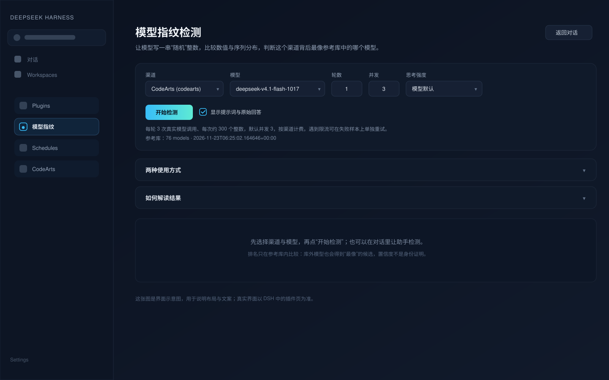
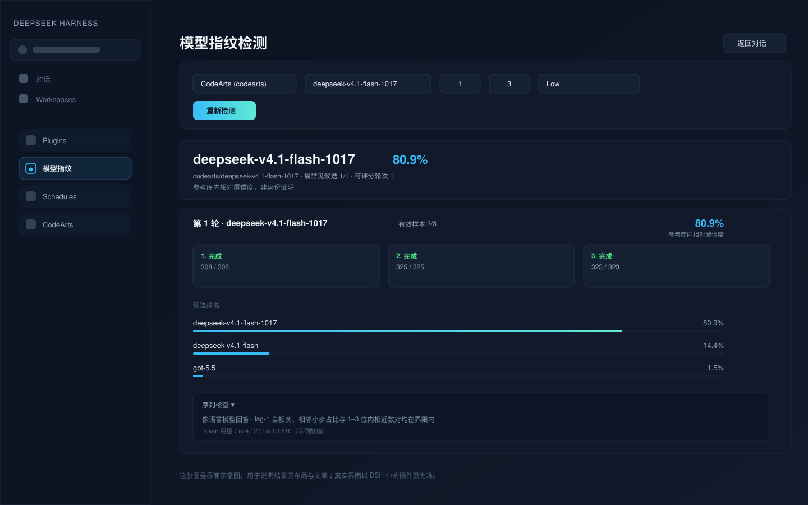

# dsh-llm-detector

**让 DeepSeek Harness 里注册的模型写一串“随机”整数，判断这个渠道背后最像哪个模型。**

[](#安装)
[](CHANGELOG.md)
[](LICENSE)
[](#数据与参考库)

语言模型写出的“随机数”并不均匀：每个模型偏好的数值、区间、末位数字和跳变方式都相对稳定。
本插件让模型凭第一反应写约 300 个 1–355 的整数，把结果与冻结的参考库比对，给出候选排名与
校准置信度；再加一个可选的单样本重试，限流时也能补齐证据。

检测请求走 DSH 自己的 `llm` 服务，用的是你当前 profile 已配置的 provider、认证和适配层——
所以它测的是“你实际在用的这条渠道”，而不是另填的 Base URL。

> 移植自 [Ikaleio/lm-detector](https://github.com/Ikaleio/lm-detector)（MIT）的数字指纹算法与参考库，
> 详见 [鸣谢](#鸣谢)。

## 界面预览

左侧边栏入口打开检测页：选渠道、模型、轮数、并发与思考强度，开始后实时显示每条样本的
状态，失败样本可单独重试。



一轮结束后给出第一候选、置信度、候选分布、序列检查与 token 用量：



> 上述两张为界面示意图，用于说明布局与文案；真实界面以 DSH 中的插件页为准。
> 如需真实截图：在已登录的 DSH 页面里打开左侧“模型指纹”，用系统截屏工具即可。

## 特性

- 🧭 **左侧边栏面板**：选渠道与模型、实时进度、取消、失败样本单独重试。
- 💬 **对话里也能用**：直接说“检测当前模型的指纹”，助手会调用 `llm_fingerprint` 工具。
- 🎚️ **思考强度可选**：读取模型真实支持的档位（low/high/max 等），也可保持模型默认。
- 📊 **可解释的结果**：第一候选、前 5 名、校准置信度、序列检查、每条样本的整数数与失败原因。
- 🔒 **不保存凭据**：请求经 DSH 的 `llm` 服务发出；页面接口不返回密钥或接口地址。
- 🧱 **只读参考库**：检测不改动参考数据；结果是参考库内的闭集排序。

## 目录

- [安装](#安装)
- [使用](#使用)
  - [左侧边栏面板](#左侧边栏面板)
  - [在对话中使用](#在对话中使用)
  - [模型工具](#模型工具)
- [原理](#原理)
- [数据与参考库](#数据与参考库)
- [限制](#限制)
- [鸣谢](#鸣谢)
- [许可证](#许可证)
- [开发](#开发)

## 安装

### 从本地目录安装（推荐）

1. 克隆仓库：

   ```bash
   git clone https://github.com/Phoeky/dsh-llm-detector.git
   cd dsh-llm-detector
   ```

2. 在 DSH 里安装该目录：

   - **图形界面**：打开 **Plugins → Add plugin**，选择这个目录；
   - **对话里**：让助手用 `plugin_manager` 执行 `install_bundle`，目标填该目录的绝对路径，
     例如 `F:\code\dsh-llm-detector` 或 `~/code/dsh-llm-detector`。

3. 安装完成后左侧边栏会出现 **模型指纹** 图标。若没有立即出现，刷新页面或重开一个会话。

插件不写 profile 的配置文件，也不保存任何密钥或接口地址。

### 更新已安装的版本

插件以目录链接方式安装，源码改动后需要让 Host 重新加载：

- 在 **Plugins** 里把该插件行**禁用再启用**；或
- 重启 DSH。

直接改文件不会热替换正在运行的模块。

### 运行要求

- Node.js `^22.19.0 || >=24.0.0`（Bun 亦可）；
- DSH 至少注册了一个 provider（`ctx.llm.listProviders()` 非空）。

## 使用

### 左侧边栏面板

点击左侧边栏的 **模型指纹** 图标（与 Plugins、Schedules 同一列），打开检测页：

1. **渠道**：选择 DSH 已注册的 provider，**模型** 下拉框会自动加载该 provider 的模型目录；
2. **轮数** 1–3、**并发** 默认 3、**思考强度** 可选模型默认或具体档位；
   “显示提示词与原始回答”默认开启；
3. 点 **开始检测**。页面实时显示每条样本的状态（排队 / 请求中 / 生成中 / 完成 / 截断采用 /
   失败）、已解析整数数和失败原因，可随时 **取消**；
4. 某条样本失败或被取消时，样本卡片上会出现 **重试**：沿用这条样本的原提示词重新采样，
   成功后自动重算本轮排名与置信度，不用整轮重跑；
5. 每轮结束后显示第一候选、置信度、前 5 个候选、序列检查与 token 用量；多轮时顶部汇总
   “最常见候选”。

页面里的“两种使用方式”和“如何解读结果”默认收起，点开即可查看说明。

置信度旁会标注“参考库内相对置信度，非身份证明”。若样本是**异常截断**（例如达到
`max-tokens`），该轮只给排名、不给校准置信度；这与“收满要求数量后主动停止”不同。

### 在对话中使用

在任何对话里直接对助手说：

> 用 llm_fingerprint 检测当前模型

也可以指定渠道和模型：

> 检测 codearts 的 deepseek-v4.1-flash-1017 的指纹，跑两轮

助手会调用 `llm_fingerprint` 工具，返回每轮的第一候选、置信度、前 5 名和样本诊断。

### 模型工具

`llm_fingerprint` 支持两个动作。

```text
action: list
```

列出 DSH 已注册的 provider；传入 `provider` 时再列出它的模型目录。

```text
action: detect
provider: codearts                 # 省略则用 DSH 当前默认模型
model: deepseek-v4.1-flash-1017    # 省略同上
rounds: 1                          # 1–3，每轮 3 次调用
samples_per_round: 3               # 1–3；少于 3 条时只排名、没有校准置信度
parallel: 3                        # 1–3 并发
reasoning_effort: low              # 可选，需为模型支持的档位
include_replies: false             # 是否在结果里附带提示词与原始回答
```

返回每轮的第一候选、前 5 个候选、置信度、序列检查、样本诊断与 token 用量，以及跨轮的
“最常见候选”。

## 原理

1. **挑战**：让模型凭第一反应写约 300 个 1–355（含端点）的整数；禁止工具、代码、从 1 数、
   等差/循环等规则化模式。每轮 3 道，长度在 292–332 中不重复抽取，语言在中/英/日/韩/法间
   独立随机，措辞由多组等价模板组合。
2. **特征**：355 维数值分布（Hellinger 嵌入）+ 74 维位置/末位 + 102 维位置核 + 220 维序列
   统计；两块基础特征按 0.75 : 0.25 拼接。
3. **序列检查**：lag-1 自相关、相邻小步占比、1–3 位内相近数对占比，三项中位数都超出界限
   时判为“不像语言模型回答”，不排名。
4. **排名**：`s = 0.5·z(频率分数) + 0.5·z(位置/顺序判别)`；频率分数由前 128 个整数的 LDA、
   最近 7 个参考回答的平方距离、以及投影掉“提示环境”低维偏移后的模型中心余弦相似度组成。
5. **置信度**：参考库内的温度 softmax。校准在离线训练时经 78 折环境留出拟合，嵌套留出
   验收通过才写入冻结检测器；不匹配时只给排名、不给置信度。

原理细节与逐项实现整理见 [docs/principle-and-implementation.md](docs/principle-and-implementation.md)。

## 数据与参考库

参考库当前为 **76 个模型、2812 条参考样本**，以冻结的 `data/detector.bin`（约 5.3 MB）与
`data/models.json` 随插件分发。

| 文件 | 内容 |
| --- | --- |
| `data/detector.bin` | 冻结的排名器与校准参数（二进制，SHA-256 绑定参考数据） |
| `data/models.json` | 参考库模型清单（ID、展示名、家族、样本数） |
| `data/LM-DETECTOR-LICENSE` | 上游项目的 MIT 许可证文本 |

## 限制

- 结果是**参考库内的闭集排序**：库外模型也会得到一个“最像”的候选，置信度不是身份证明。
- 参考库用裸 API 的文字提示词采集；DSH 的适配层可能注入系统提示或改写请求，结果可能偏离。
- 同源、蒸馏或共用分词器的模型指纹天然接近，可能互相混淆。
- 渠道限流（例如每账号并发上限）会让部分样本失败，可在样本卡片上单独重试。
- 本版本不含分词器探测（对照 API 的 token 计数反推上游分词器）与图片模式。
- 检测结果只保存在 DSH 进程内，重启后清空。

## 鸣谢

本插件建立在前人工作之上：

- **[Ikaleio/lm-detector](https://github.com/Ikaleio/lm-detector)**（LM Fingerpoint Detector，MIT，
  Copyright (c) 2026 xqy2006）——数字指纹算法、冻结检测器与参考库的直接来源。本仓库的
  `lib/fingerprint.js`、`lib/positional.js`、`lib/detector.js`、`lib/codec.js`、`lib/challenge.js`
  是对其 TypeScript/JavaScript 实现的移植，`data/detector.bin` 与 `data/models.json` 由其数据派生。
  上游许可证见 `data/LM-DETECTOR-LICENSE`，修改说明见 [NOTICE](NOTICE)。
- 上游项目又致谢 **[xqy2006/ModelTrace](https://github.com/xqy2006/ModelTrace)** 提供的算法思路参考和部分原始数据。

此外，感谢 DSH 提供的 `llm`、`tools`、slot 与 webServer 扩展点，以及本地验证时使用的各 provider 渠道。

## 许可证

[MIT](LICENSE) © 2026 Phoky。移植与数据来源见 [NOTICE](NOTICE)。

## 开发

```bash
node --version          # ^22.19 或 >=24
node --check index.js   # 语法检查

node scripts/smoke.mjs        # 离线：编解码往返、合成排名、序列检查
node scripts/retry-test.mjs   # 离线：失败样本单独重试
node scripts/ui-flow.mjs codearts deepseek-v4.1-flash-1017   # 真实：走 UI 相同 HTTP 路由
```

`scripts/build-data.mjs` 可从 lm-detector 的 `unified_bank.json` 与 `shared_detector.bin`
重新生成 `data/models.json` 与 `data/detector.bin`：把 bank 放到仓库根的 `data-bank.json`，
把冻结检测器放到 `data/upstream/shared_detector.bin`（两者都不提交）。

插件结构：

| 路径 | 职责 |
| --- | --- |
| `index.js` | Host 插件：注册 `llm_fingerprint` 工具与 `/api/llm-detector/*` 路由 |
| `client.js` | 浏览器端：左侧边栏图标与检测面板 |
| `lib/runner.js` | 检测作业编排：UI 与工具共用，含取消、重试、单样本状态 |
| `lib/routes.js` | 同源 HTTP 路由（bootstrap / models / model / start / job / cancel / retry） |
| `lib/detect.js` | 经 `ctx.llm.stream` 采样与截断判定 |
| `lib/detector.js` | 排名、校准与结果判定 |
| `lib/challenge.js` | 五种语言的挑战生成 |
| `lib/data.js`、`lib/codec.js` | 参考数据加载与二进制检测器解码 |
